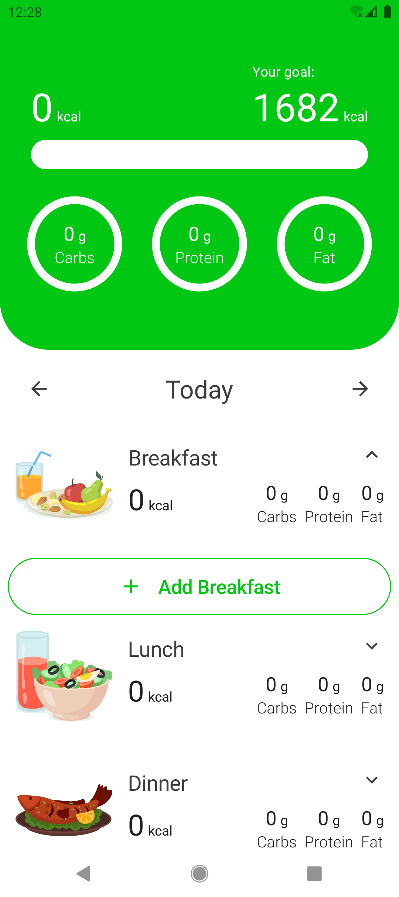
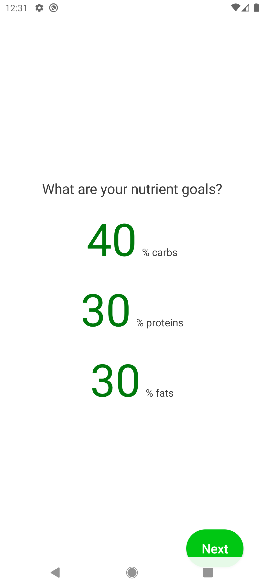
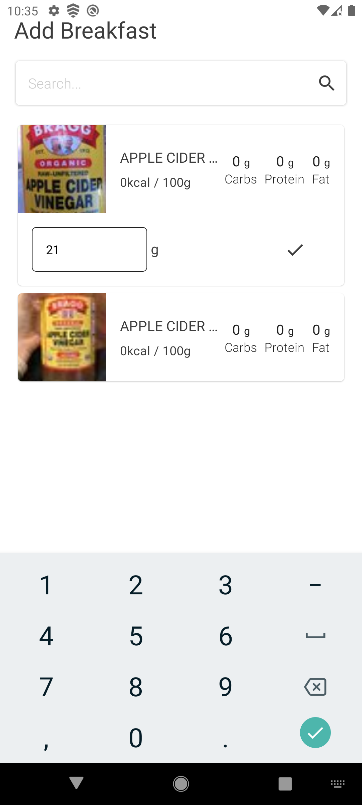

# 🍎 Calorie Tracker App

A simple and intuitive calorie tracking application that helps users monitor their daily food intake and maintain a healthier lifestyle.

## 📌 About the Project

This app allows users to input their personal data and calculates the recommended daily calorie intake. Users can search and add meals for breakfast, lunch, and dinner, and track their total calories throughout the day.

---

## 🚀 Features

* Calculate daily calorie needs based on user data
* Search and add meals easily
* Track calories for:

  * Breakfast
  * Lunch
  * Dinner
* Real-time calorie summary
* Simple and user-friendly interface

---

## 🖼️ Screenshots

---

## 🛠️ Tech Stack

### 📱 Language & Platform

* Kotlin
* Android (minSdk 28 / targetSdk 34)

---

### 🎨 UI

* Jetpack Compose
* Compose Navigation
* Material Design (Compose Material)
* Coil (image loading)

---

### 🏗️ Architecture

* Multi-module setup (Clean Architecture)
* MVI pattern (ViewModel + State + Event)
* Feature-based modules:

  * Onboarding
  * Tracker
    *(each with separate domain / data / presentation layers)*

---

### 💉 Dependency Injection

* Dagger Hilt

---

### 🌐 Networking

* Retrofit
* OkHttp
* Moshi (JSON serialization)
* OpenFoodFacts API

---

### 💾 Local Storage

* Room (SQLite)
* DataStore Preferences

---

### ⚡ Asynchronous Programming

* Kotlin Coroutines
* Kotlin Flow

---

## ⚙️ How It Works

1. User enters personal information
2. App calculates daily calorie needs
3. User searches for meals
4. Meals are added to daily tracker
5. Total calories are updated automatically

---

## 📄 License

This project is open-source and available under the MIT License.
